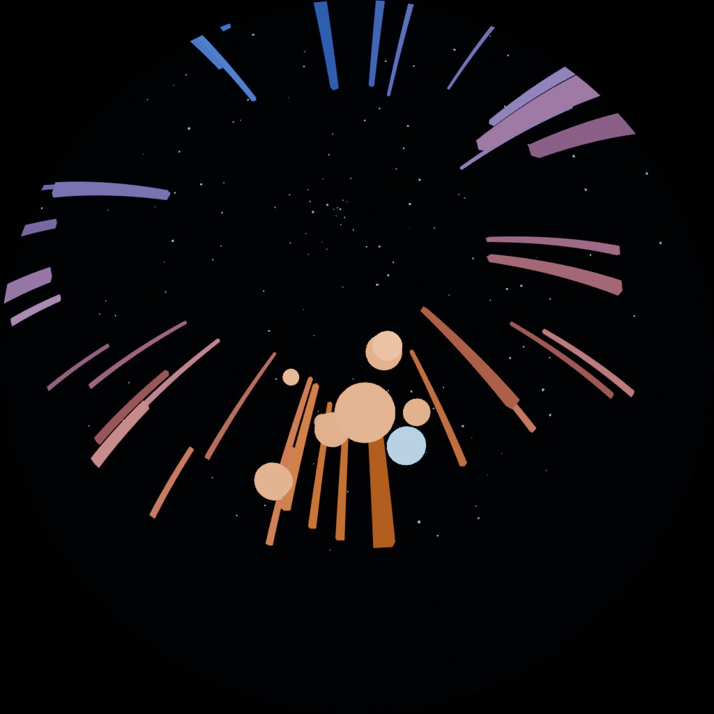
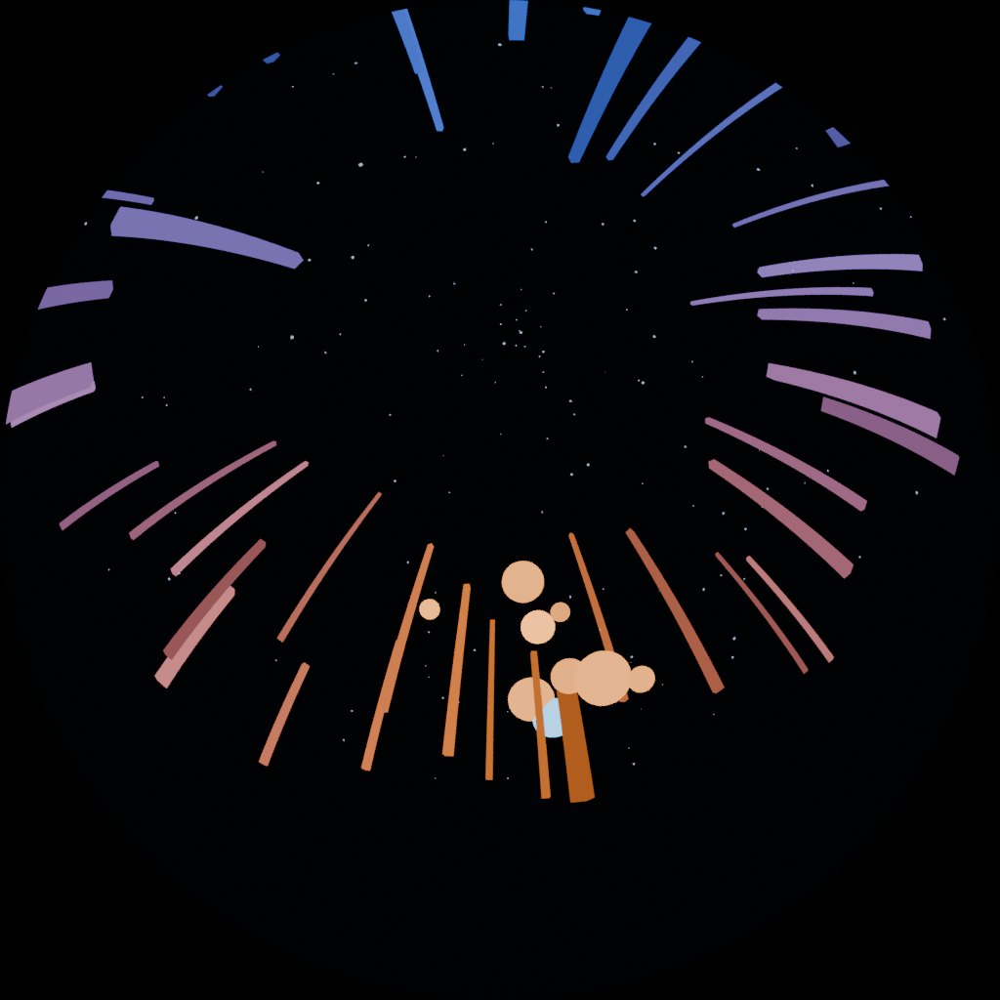

# EX-01 Drift · Blender

**A film · renders as it stands · the default choice for a 3-D piece**

A luminous field of shards rising from the horizon, drifted slowly through. Forty seconds, 1200 frames, and everything in it is placed by angle, not by eye.

{ width="480" }

## Files

| File | What it is |
|---|---|
| [`drift.py`](files/EX-01-blender/drift.py) | The whole piece: builds the scene, animates it, renders it. About 190 lines, heavily commented |
| [Rendered result (.mp4)](https://github.com/dcuartielles/wisdome-360/releases/download/examples-media/EX-01_drift_1024x1024_30fps.mp4) | 1024², 40 s, on GitHub Releases. Open it in the [Dome Simulator](../tools/dome-simulator.html) |

## Run it

```bash
blender --background --python drift.py      # normal Blender
python3 drift.py                            # if you pip-installed bpy
```

The settings are at the top: `RES`, `FRAMES` and `SAMPLES`. Design at `RES = 1024`. A 2048² render takes about four times as long, and you don't want to wait for it to find out the composition is wrong.

## The five lines that make it a dome render

```python
cam.data.type          = 'PANO'
cam.data.panorama_type = 'FISHEYE_EQUIDISTANT'
cam.data.fisheye_fov   = radians(180)
cam.rotation_euler     = (radians(180 - 26), 0, 0)   # look up, leaning 26° to the front
scene.render.resolution_x = scene.render.resolution_y = 2048   # SQUARE
```

**The rotation is the one everyone gets wrong.** Blender's camera looks down its own −Z. Rotating 180° about X swings it to world +Z, straight up. Rotate 90° instead, the obvious guess, and you render the horizon: it looks fine on a monitor and is completely wrong on a dome.

Wisdome Malmö is **tilted 26°, raised at the back**, so the dome's zenith is 64° up, in front of the audience. Rotating 180° − 26° = 154° leans the camera the same way, which keeps the world level for the audience: elevation in your scene is then elevation from the seats.

That rotation puts world **+Y at the bottom of the image**, so +Y is the front of the room.

## Compose by angle: `place_at()`

```python
def place_at(obj, elevation_deg, azimuth_deg, distance):
    e, a = radians(elevation_deg), radians(azimuth_deg)
    obj.location = (distance * cos(e) * sin(a),
                    distance * cos(e) * cos(a),
                    1.6 + distance * sin(e))
```

Copy this into every Blender dome project. With the tilted camera, elevation is the audience's (0 = eye level). "Put the subject where people can see it" becomes `-60 <= azimuth_deg <= 60` and `15 <= elevation_deg <= 60`, and the sweet spot is `place_at(obj, 40, 0, d)`. See [Where to put things](../reference/comfortable-zone.md).

The shards get their height the same way: the script picks the **elevation their tops should reach** and solves for the height, instead of picking a height and hoping.

## Three things that make it render fast enough

At the settings this example started with, 1200 frames took nearly four hours on two CPU cores. Now it is about one. Check all three in your own scene before a long render.

1. **There is no floor.** Tilted like the venue, the dome camera sees only about 16° below eye level at the front and starts about 36° up at the back. The ground is almost never on screen, and where it is, it is behind the seat backs. Build the half of the scene that shows.
2. **Denoising is off.** Almost every surface is an emission shader seen directly, so there is barely any noise. The denoiser took 7 s a frame on top of a 3 s render. Turn it back on the moment you add real lights, glass, volumetrics or depth of field.
3. **16 samples, not 50.** On an emissive scene, 8 and 16 samples are hard to tell apart. Render one frame at several sample counts and *look*.

Measured on two CPU cores at 1024²:

| Settings | Per frame | 1200 frames (40 s) |
|---|---|---|
| 24 samples + denoising | ~13 s | ~4 h 20 min |
| 16 samples, no denoising | ~3.2 s | ~1 h 5 min |
| 8 samples, no denoising | ~1.8 s | ~36 min |

At 2048², multiply by about four. A GPU (`scene.cycles.device = 'GPU'`) changes these numbers completely.

## The motion: a closed loop, not a dolly

Over forty seconds a straight dolly is a trap. Slow enough to be comfortable, it barely moves; fast enough to feel like travel, it pushes out through the far side of the scene. So the camera walks a **closed loop**, out, around and back, while the yaw eases out and back over the same cycle:

```python
cam.location.x = LOOP_X * sin(t * tau)             # out and back
cam.location.y = LOOP_Y * (1.0 - cos(t * tau))     # forward and back
cam.location.z = 1.6 + BOB_Z * sin(t * tau * 2.0)
```

The parallax changes all the time, the framing stays balanced to the last frame, and the piece has somewhere to end.

{ width="360" }

## Try changing first

- `N` and the shard distance range: a denser, closer field feels like a forest.
- `TOTAL_YAW` to 60, then watch it in the simulator. You will see why the loop is led by translation, not rotation.
- `LOOP_X` and `LOOP_Y` to 0, so the camera never moves. No camera motion at all is a legitimate choice, and often a better one.
- The `COLD` / `WARM` pair. Colour reads far more strongly on a dome than on a screen.
- A second `place_at` call inside the orb loop, to make them spiral.

## What usually breaks

| Symptom | Cause |
|---|---|
| You see the horizon in a ring, the sky in the middle is empty | Camera rotated 90° instead of 154° |
| The subject floats over everyone's heads | Placed by XYZ instead of `place_at()`, or elevation over 60° |
| The render is very slow and looks the same at fewer samples | Denoising on, too many samples, a floor nobody sees |
| The last ten seconds fall apart | A dolly that leaves the scene. Render the *last* frame before the sequence |

Render one frame first, then one frame at the end of the animation, then the sequence. Encode with the line in the [delivery spec](../reference/delivery-spec.md#video).

The `.mp4` here is encoded at a lower, variable bitrate so it downloads quickly. Your own delivery must use the 60 Mbit/s CBR line.
