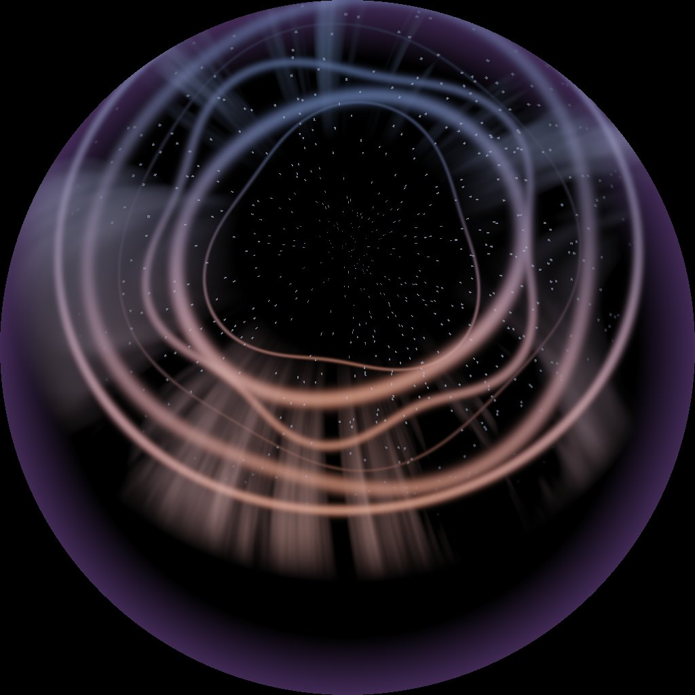

# EX-03 Pulse · WebGL / GLSL

**A live piece · runs right now, in any browser · no install**

A live dome master drawn every frame by one fragment shader and driven by the microphone. No licence, no build step: open the file.

{ width="480" }

## Files

| File | What it is |
|---|---|
| [`pulse.html`](files/EX-03-webgl-glsl/pulse.html) | The whole thing. One file, no dependencies. [Open it now](files/EX-03-webgl-glsl/pulse.html){ target="_blank" } or save it and double-click it |

## Run it

Open the file, press **Enable microphone** and talk. A room full of people can push it around with their voices, which is about the cheapest real interaction there is.

| Control | |
|---|---|
| **Dome output** | Fullscreen, square, no panel. This is what goes to the dome |
| **Save PNG dome master** | One frame, at the current resolution |
| **Record fallback clip** | Records the canvas to `.webm`: the recording you bring in case the live set-up fails |
| ++g++ | Comfortable zone and sweet spot guide |
| ++f++ | Front marker |
| ++h++ | Hide the panel |

Convert the recording to the [delivery spec](../reference/delivery-spec.md#video):

```bash
ffmpeg -i pulse_fallback.webm -vf scale=2048:2048 -c:v libx264 -profile:v high \
       -pix_fmt yuv420p -b:v 60M -maxrate 60M -bufsize 120M -r 30 pulse_fallback.mp4
```

## What the shader does

Read `STEP 1` in the fragment shader. It is a handful of lines and it is the whole idea:

```glsl
vec2 p = (gl_FragCoord.xy / uRes) * 2.0 - 1.0;   // -1..1
float r = length(p);
if (r > 1.0) { black; return; }                  // outside the circle
vec3  rd   = roomDir(p);                         // this pixel, as a direction in the room
float elev = degrees(asin(rd.z));                // 0 = eye level, 90 = straight up
float az   = degrees(atan(rd.x, rd.y));          // 0 = the front of the room
```

After those lines you are no longer writing a screen shader. You are writing a function of **where in the room, as the audience sees it**, and every dome rule becomes something you can write down. `smoothstep(5.0, 14.0, elev)` *is* "fade out towards eye level".

`roomDir()` is the only place that knows the dome is tilted. The centre of a dome master is the dome's own zenith, which in Wisdome Malmö is 64° up in front of the audience. `roomDir()` undoes the tilt.

Press ++g++ to see where things go. The ribbons are the subject: 16°–60° above eye level and brightest in front (`front` in STEP 1 dims them to a third behind the audience). The curtains and the point field are ambience and wrap the whole room.

## The seam bug, and the fix

Noise fed raw azimuth is not periodic: `noise(0)` ≠ `noise(360)`, so you get a hard vertical seam down the front of the dome. The first version of this shader had exactly that. The fix, in `STEP 3`, samples the noise **on a circle**:

```glsl
float ar = radians(az);
vec2  q  = vec2(cos(ar), sin(ar)) * 4.5 + vec2(cos(ar*3.0), sin(ar*3.0)) * 1.4;
float cz = fbm(q + vec2(travel * 0.20, elev * 0.02));
```

Periodic by construction. You will hit this bug in your own shader; now you know what it is.

## Getting it onto the dome

The browser window is your output. To rehearse, share the window into the [Dome Simulator](../tools/dome-simulator.html). On the day, how it reaches the dome depends on the route, see [Connecting a live piece](../reference/connecting.md):

- **NDI + Dante:** send the window with an NDI screen-capture tool.
- **HDMI:** the HDMI signal is 16:9. Put the browser on that display, press **Dome output**, and the square master sits in the middle with black at the sides.

Either way: turn off notifications, screen savers and automatic updates. An update banner on a dome is enormous. Measure the latency in the room (press a key, watch the dome); if it is over about 100 ms, design the interaction so timing doesn't matter.

## Try changing first

- `uBands`: how many ribbons. The loop stops at 14.
- `front` in STEP 1: set it to `1.0` everywhere and the ribbons are as bright behind the audience as in front. The piece loses its direction.
- The `lobes` and `amp` lines in STEP 2: this is where the rosette shapes come from.
- `tint` in STEP 4: swap the warm and cool colours.
- Replace the microphone with OSC from phones, and the audience controls the piece with no extra hardware.

## What usually breaks

| Symptom | Cause |
|---|---|
| A hard vertical line down the front of the dome | Noise sampled on raw azimuth. Sample it on a circle |
| The microphone does nothing | The page needs a click on **Enable microphone**, and some browsers only allow it from `https://` or `localhost`. Serve the folder (`python -m http.server`) if a double-clicked file refuses |
| The picture is stretched on the dome | The output is not square. Use **Dome output**, never a resized window |
| It stutters | The shader is too heavy for the laptop. The canvas is as big as the window (or the screen, in Dome output), so try a smaller window or fewer **Bands** to find out, then simplify the shader |
