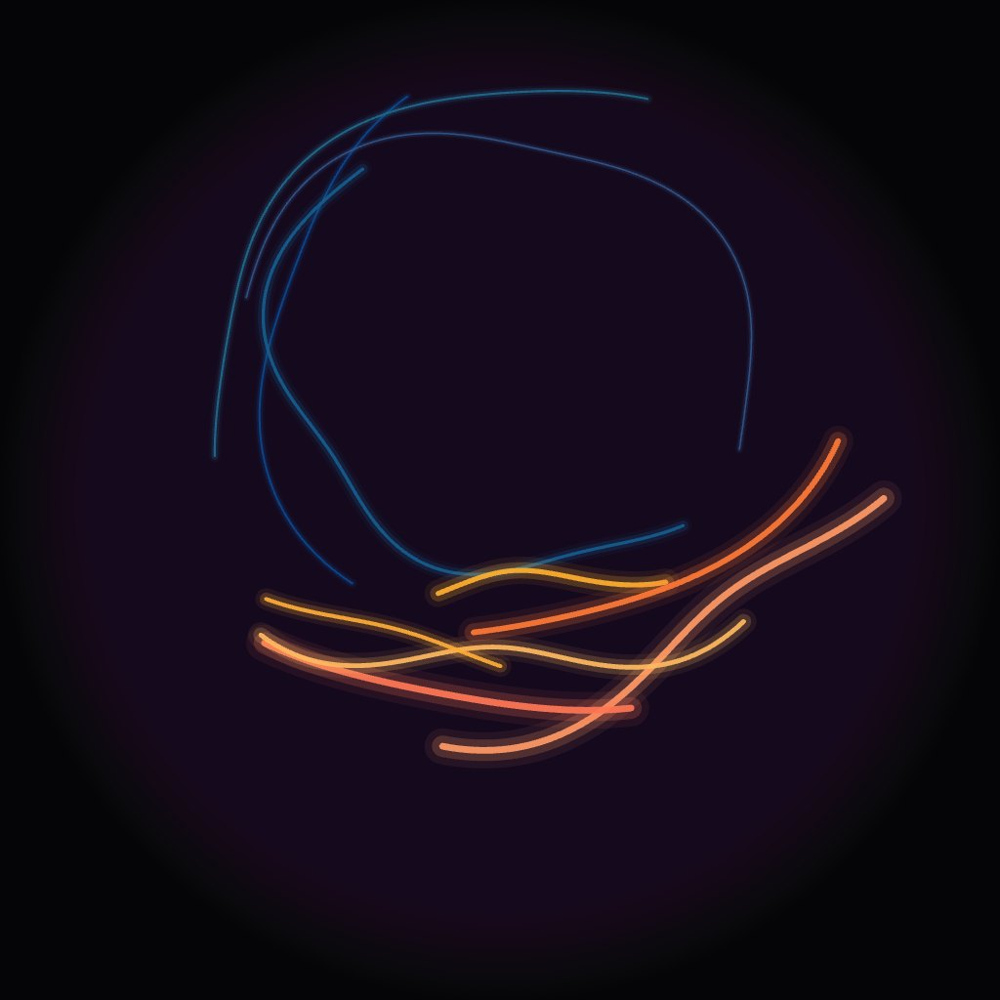

# EX-04 Chorus · p5.js

**A film or a live piece · the gentlest place to start · runs offline**

If you have written a p5 sketch, you can write a dome piece today. This is the smallest bridge between the two: arcs of light, "voices", drawn in the audience's angles.

{ width="480" }

## Files

| File | What it is |
|---|---|
| [`chorus.html`](files/EX-04-p5js/chorus.html) | The sketch. [Open it now](files/EX-04-p5js/chorus.html){ target="_blank" } |
| [`vendor/p5.min.js`](files/EX-04-p5js/vendor/p5.min.js) | p5.js 2.3.1, bundled so the sketch works offline. Save it in a `vendor/` folder next to `chorus.html` |

| Key | |
|---|---|
| ++s++ | Save a PNG dome master |
| ++g++ | Comfortable zone and sweet spot guide |
| ++r++ | Reseed |
| click | Add a voice at that angle |

## The one function

```js
const p = roomXY(azimuth, elevation);   // -> [x, y] on the canvas, or null
```

`azimuth` and `elevation` are **the audience's** angles: azimuth 0 is the front of the room, elevation 0 is eye level. That is the whole adaptation. Every p5 habit still works; you stop passing `(x, y)` and start passing `(azimuth, elevation)`.

Inside, `roomXY` does two small steps:

```js
function roomXY(azDeg, elDeg) {
  const d = roomToDome(azDeg, elDeg);        // tilt the audience's angles into the dome's
  return d ? domeXY(d[0], d[1]) : null;      // null = below the dome's rim
}
function domeXY(azDeg, elevDeg) {            // dome angles -> equidistant fisheye
  const c = RES / 2;
  const r = (1 - constrain(elevDeg, 0, 90) / 90) * c;   // linear in angle
  const a = radians(azDeg);
  return [c + r * sin(a), c + r * cos(a)];              // az 0 -> bottom = front
}
```

Two steps because the centre of a dome master is the **dome's** zenith, and Wisdome Malmö is tilted 26°, raised at the back: that zenith is 64° up, in front of the audience. `roomToDome` deals with it, and nothing else in the sketch has to know.

## Where things go

Press ++g++. The comfortable zone is a patch *in front*: 15°–60° above eye level, ±60° either side. The sweet spot is straight ahead, 40° up. See [Where to put things](../reference/comfortable-zone.md).

Chorus has two kinds of voice. Six warm **lead** voices are the subject: they are born inside the zone and turn back at its edge, so they stay in front. Four quiet blue **ambient** voices circle the whole room, higher up. Click inside the zone to add a lead voice, anywhere else for an ambient one.

## The one thing that really is different

**A straight line is not straight on a dome.** A stroke at constant elevation is an arc. So you can't use `line(a, b)`: walk the path in azimuth and let `roomXY` bend it.

```js
function roomArc(az0, az1, elevFn, steps = 200) {
  const pts = [];
  for (let i = 0; i <= steps; i++) {
    const t  = i / steps;
    const az = lerp(az0, az1, t);
    pts.push([az, elevFn(az, t)]);
  }
  roomPath(pts);   // draws through roomXY, and breaks the line where it leaves the dome
}
```

200 steps is plenty. Fewer, and the arcs look faceted once they are stretched across eleven metres of dome.

## Making a film from it

p5 has no video export, so save frames and encode them. In `draw()`:

```js
if (frameCount <= 150) saveCanvas('frame_' + nf(frameCount, 4), 'png');
```

Set `RES = 2048` first, allow the browser to download many files, then encode with the line in the [delivery spec](../reference/delivery-spec.md#video).

As a live piece, the browser window is your output: see [Making a live piece](../make/live.md).

## Try changing first

Everything is decided in `newVoice()`. Try these, pressing ++g++ each time:

1. Give the lead voices an elevation of `random(60, 85)`. The subject is now over everyone's heads and the piece goes dead.
2. Give them an azimuth of `random(-180, 180)`. Half of them end up behind the audience, where nobody sees them.
3. Put one lead voice at `newVoice(true, 0, 40)` with `speed: 0`: a subject sitting in the sweet spot.

Five minutes of this teaches more than this page.

## What usually breaks

| Symptom | Cause |
|---|---|
| A blank page | `vendor/p5.min.js` isn't next to `chorus.html`, in a folder called `vendor` |
| Lines cut straight across the dome | `line()` used instead of `roomArc()` / `roomPath()` |
| The film plays at half the speed of the sketch | Speeds are in degrees **per frame**, and p5 draws at 60 fps by default, while the film plays at 30. Add `frameRate(30)` in `setup()` so the sketch looks like the film |
| Things vanish near the bottom of the circle | `roomXY` returns `null` below the dome's rim. Check for it before you draw |
