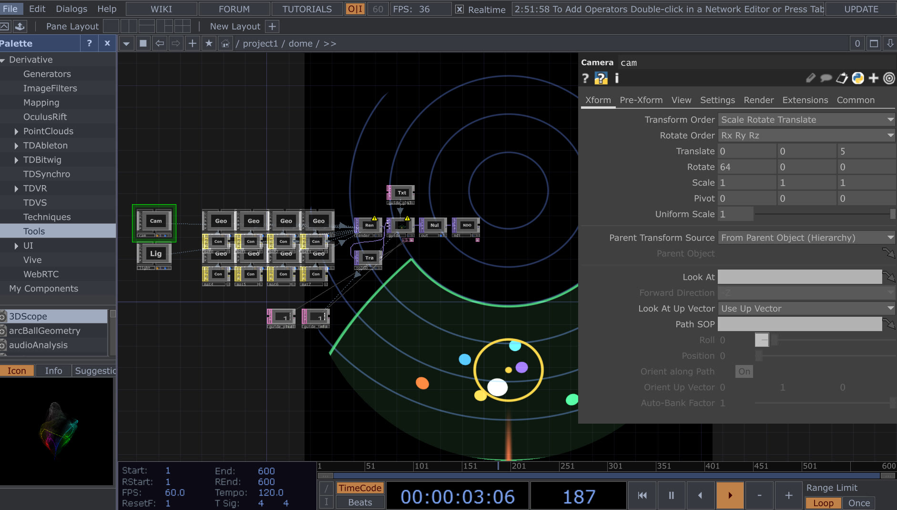

# EX-05 · TouchDesigner

**A live piece · a ready-made network, a recipe and two working GLSL TOPs · the fastest route to an interactive dome piece**

TouchDesigner's free non-commercial licence covers personal and course work, and it renders an equidistant fisheye natively, so 3-D scenes need no shader tricks. This example gives you a network that is ready to run, the two things TouchDesigner doesn't have out of the box, and the eight steps to a dome render.



## Files

| File | What it is |
|---|---|
| [`01_domemaster_guide.glsl`](files/EX-05-touchdesigner/01_domemaster_guide.glsl) | A GLSL TOP that draws the comfortable zone, the sweet spot, eye-level rings and the front marker over any fisheye render, measured from the audience with the 26° tilt taken into account. Keep it in your network while you work; bypass it for delivery |
| [`03_build_dome_network.py`](files/EX-05-touchdesigner/03_build_dome_network.py) | Builds the whole network for you (below). Run it in the Textport, then save the project as a `.toe` |
| [`EX-05_dome_demo.toe`](files/EX-05-touchdesigner/EX-05_dome_demo.toe) | The network the script builds, saved from TouchDesigner 2023. Open it and go into `/project1/dome`. In this saved copy, set the `cam` Camera COMP's **Translate Z** to 0 (it was saved at TouchDesigner's default, 5) and ignore the `ndi` node: Wisdome takes the picture over HDMI. Running the script gives you the corrected version |
| [`02_equirect_to_domemaster.glsl`](files/EX-05-touchdesigner/02_equirect_to_domemaster.glsl) | A GLSL TOP that turns 360° (equirectangular) footage into a correct dome master. For Wisdome, set its `uTilt` to **−26** |

Each file lists the uniforms to add on the GLSL TOP's *Vectors* page in its header.

## The ready-made network

1. Open TouchDesigner with a new project and open the Textport: **Dialogs → Textport and DATs** (Alt+T).
2. Paste these two lines, with the folder where you saved the EX-05 files, and press Enter:

    ```python
    EX05 = r'C:\path\to\EX-05-touchdesigner'
    exec(open(EX05 + r'\03_build_dome_network.py', encoding='utf-8').read())
    ```

3. Double-click `dome` and press **h** to see the whole network. The Textport lists what it set, and anything you need to set by hand.
4. **File → Save As** to keep it as a `.toe`.

It builds the eight steps below: a camera at the centre leaning like the dome, eight orbs placed by angle in the comfortable zone, the fisheye render, the 180° → 160° scale, the guide overlay and the Null that goes to the dome. Replace the orbs with your own scene.

## A fisheye render in eight steps

1. **Camera COMP** → *Xform* page: **Translate** `0 0 0` (the centre of the dome, where the audience sits; TouchDesigner's default is Z = 5) and **Rotate X = 64**. 90 would look straight up; 64 leans it 26° towards the front (−Z), which is how Wisdome Malmö is tilted. Now world angles are the audience's angles. The Camera COMP has no fisheye setting: that is on the Render TOP.
2. **Render TOP** → Camera = that COMP, **Render Mode** `Fish-Eye (180)`. TouchDesigner's fisheye is fixed at 180°, but Wisdome's player spreads the whole circle of the master over its 160° screen, so a 180° render arrives squeezed towards the centre by 8/9. Add a **Transform TOP** after the Render TOP with **Scale** `1.125 × 1.125` (180/160): the 160° circle now fills the square.
3. **Render TOP** → *Common* page → **Resolution** `Custom`, `2048 × 2048`. Square, always. Work at 1024 if the laptop struggles.
4. Build the scene as normal: Geo COMPs, instancing, particles. *Place things by angle* (below).
5. Put `01_domemaster_guide.glsl` on a GLSL TOP after the Transform TOP, wired into input 0. `uGuide` on while you work, `uTilt` at 26.
6. Add your inputs: **Audio Device In CHOP** for sound, **Mouse In**, **OSC In** for phones, **Serial** or **Arduino** for sensors.
7. A **Null TOP** at the end of the chain. This is what goes to the dome.
8. Output from that Null over HDMI (below).

## Place things by angle, not by position

In a Geo COMP's transform, or a Script DAT driving instancing, convert (azimuth, elevation, distance) into XYZ instead of nudging translate values:

```python
import math
def place(az_deg, elev_deg, dist):
    a, e = math.radians(az_deg), math.radians(elev_deg)
    return (dist * math.cos(e) * math.sin(a),   # x
            dist * math.sin(e),                 # y  (TouchDesigner is Y-up)
            -dist * math.cos(e) * math.cos(a))  # z  (-Z is the front)
```

With the camera tilted as in step 1, elevation is the audience's: 0 = eye level. The subject belongs in `-60 <= az_deg <= 60 and BAND[0] <= elev_deg <= BAND[1]`, a patch **in front** from the rim at the front (about −16°) up to about 45°, with the sweet spot at `place(0, SWEET_EL, dist)`, about 20° up. The numbers come from the venue's own scale: Wisdome counts angles **in the image**, 0 at the rim and 90 at the centre, and their sweet spot is "40". Straight ahead:

```python
TILT, FOV, SWEET_VENUE = 26, 160, 40
SWEET_EL = (90 - TILT) - (1 - SWEET_VENUE / 90) * FOV / 2   # ≈ 19.6
BAND     = ((90 - TILT) - FOV / 2, SWEET_EL + 25)           # ≈ −16 (the rim) … 45
```

"Sweep it around the audience" is adding to `az_deg` over time; anything that sweeps out of that patch has become ambience. See [Where to put things](../reference/comfortable-zone.md).

## 360° footage

`02_equirect_to_domemaster.glsl` is not the same as stretching a panorama into a circle. Equirectangular footage stores elevation linearly *down the frame*; a dome master stores it linearly *along the radius*. Getting this wrong is the most common reason 360° footage "looks nearly right but wrong" on a dome.

Set `uTilt = -26` so the footage's horizon stays level for the audience in the tilted dome, and `uRotate` to turn the part of the footage you care about to the front.

## Sending it to the dome

The picture goes **over HDMI** and the sound **over Dante**. See [Connecting a live piece](../reference/connecting.md).

| | In TouchDesigner |
|---|---|
| **Picture** | A **Window COMP** fullscreen on the HDMI display, or the Null captured in OBS and shown with its Fullscreen Projector. The display runs at 3840 × 2160, with the square master in the middle, 2160 × 2160, and black at the sides |
| **Sound** | An **Audio Device Out CHOP** with 6 channels (5.1) to Dante Virtual Soundcard or the course's Dante box. If Dante fails, send stereo to the HDMI sound device |

Rehearse with the [Dome Simulator](../tools/dome-simulator.html): share the window, use a virtual Dome monitor, or use a USB HDMI capture card. In the room, measure the latency with something that flashes on a key press; over about 100 ms, design the interaction so it doesn't depend on tight timing.

## Record the fallback

Every live piece needs a recording to play if the set-up fails.

- **Movie File Out TOP** on the final Null: H.264, 30 fps, square, 2048².
- Or record frames and encode them with the line in the [delivery spec](../reference/delivery-spec.md#video).

## What usually breaks

| Symptom | Cause |
|---|---|
| The guide's zone sits round the middle of the circle | `uTilt` on the guide is 0. It should be 26 |
| 360° footage has a tilted horizon in the dome | `uTilt` on the equirect shader is 0. It should be −26 |
| The subject is overhead | Camera Rotate X is 90, or things placed by translate values instead of `place()` |
| The picture is squashed over HDMI | The square master was stretched to fill the 16:9 signal. Keep it square, 2160 × 2160 in the middle, black at the sides |
| Everything sits lower and closer to the centre than you placed it | The Transform TOP that scales the 180° render by 1.125 is missing |
| Things are in the wrong place, and the error grows the closer they are | The camera is not at the centre: its Translate should be `0 0 0` |
| The render is a flat picture, not a circle | Render TOP **Render Mode** is `2D`. It should be `Fish-Eye (180)` |
| The guide draws nothing, or draws in the wrong place | A uniform from the file header is missing on the *Vectors* page, so it is 0 |

## Worth reading

- [Fulldome Simulator `.tox`](https://github.com/theinfranet/TouchDesigner-Fulldome-Simulator), a dome preview inside TouchDesigner
- [Derivative, dome tag](https://derivative.ca/tags/dome)
- [TouchDesigner to a Sky-Skan dome, live](https://forum.derivative.ca/t/touch-to-sky-skans-digital-sky-2-system-for-live-dome-video/3710)
