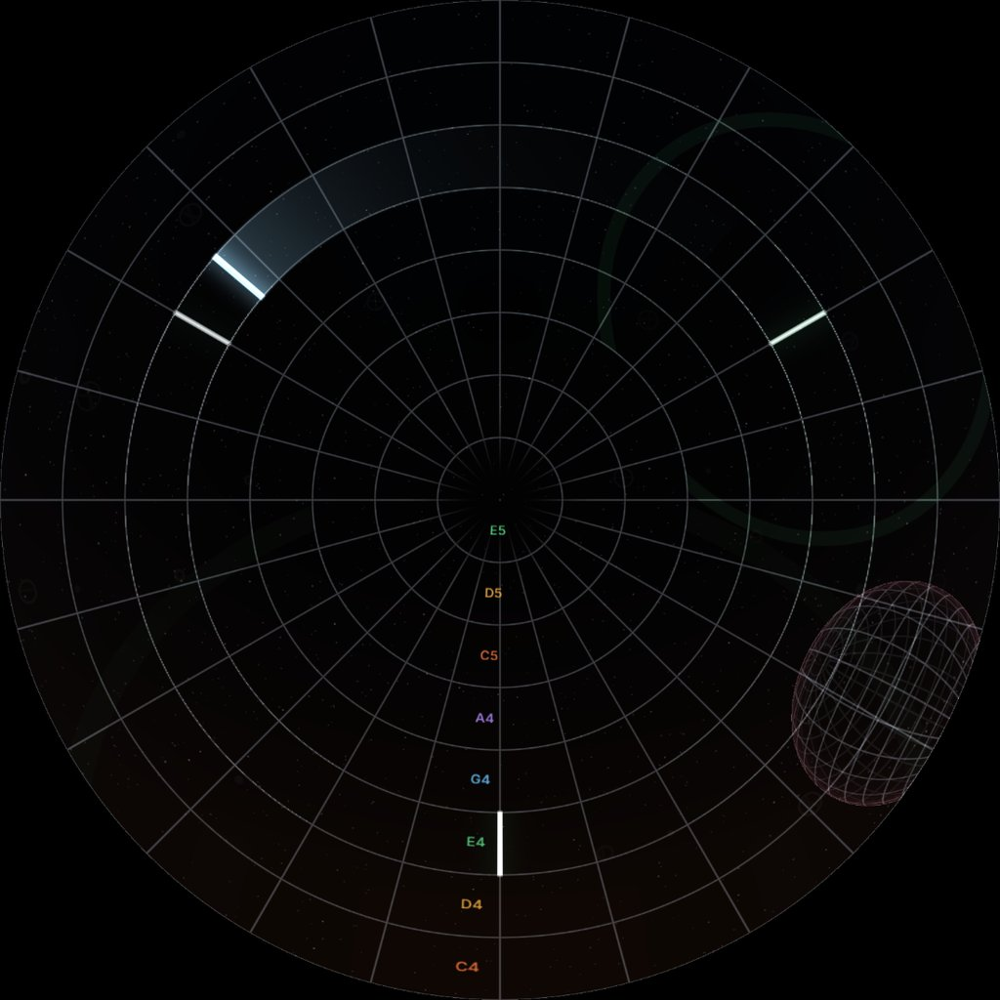

# EX-11 Orbit · the dome as an instrument

**A live piece · WebGL + Web Audio · picture and 5.1 sound · no install**

Three spheres of metal mesh orbit one another in a void: a **keyboard**, **drums** and a distorted **guitar**. You start at the centre of the keyboard. Bars orbit inside each sphere and hum. White lines are notes: when a bar sweeps over a line at its own height, the line plays. You write the music by clicking on the dome.

{ width="480" }

## What it teaches

- **Sound placed in the room.** Every note comes from where its line is, and every hum travels round the 5.1 ring with its bar. Picture and sound share one set of directions.
- **One clock for picture and sound.** Nothing is detected. The moment of every note is solved for, ahead of time, so what you see and what you hear can't drift apart.
- **A whole world from a log.** Every click, flight and turn is a timed entry. The picture and the sound rebuild everything from it, every frame.
- **Ray tracing in a fragment shader.** Inside a sphere, the camera sits at its centre, so the picture is a fisheye of the sphere around you. Flying out is the same shader with the camera somewhere else.

## Files

| File | What it is |
|---|---|
| [`orbit.html`](files/EX-11-orbit/orbit.html) | The whole piece. One file, no libraries. [Open it now](files/EX-11-orbit/orbit.html){ target="_blank" } or save it and double-click it |
| [`README.md`](files/EX-11-orbit/README.md) | The instrument, the score and the controls, for the folder |
| [`preview/still-master.jpg`](files/EX-11-orbit/preview/still-master.jpg) | The dome master at 31 s, note names on |
| [`preview/still-flyout.jpg`](files/EX-11-orbit/preview/still-flyout.jpg) | After **Fly out**: the three spheres from outside |

## Run it

Open the file and press **Start sound**. The picture runs without sound too. Then wait, or press ++n++ to skip ahead.

| Time | What happens (in the keyboard) |
|---|---|
| 0 s | One bar in the 20–30° band (E4), starting behind you, one orbit every 4 s, humming |
| 20 s | A white line straight ahead. The bar speeds up over 3 s to one orbit every 2 s, and plays the line once per orbit |
| 30 s | Two more lines at ±120°: three notes per orbit, from the front, back right and back left |

`orbit.html?t=31` starts 31 s in. That is handy for testing, and for showing someone the instrument without the wait.

**Height is pitch.** Each sphere is cut into 10° bands, from its rim up to its pole, and the mesh's rings are the band edges. One note per band. Keyboard: C major pentatonic, C4 at the rim up to E5. Drums: kick, toms, snare, clap, hats. Guitar: E minor pentatonic from E2. Below the rim the scale goes on down, and the drums have a second kit. Press ++l++ to see the names.

| Do | What happens |
|---|---|
| Click an empty cell | A line. If that height has no bar yet, one starts on the line, so you hear it at once |
| Click a line | Another bar at that height, starting from the line |
| ++shift++ + click a line | Removes it. A height's last line takes its bars with it |
| ++shift++ + drag | Turns the sphere you are in. Up and down tips it, to reach the southern half |
| **Fly out** (++o++) | Leave backwards: the three spheres float ahead of you, in a void. The further away, the quieter |
| Double-click a sphere from outside, or **Into …** (++1++ ++2++ ++3++) | Fly into it |
| **Clear my notes** (++c++) | Removes everything you added |
| ++r++ | Restart: score, clicks, flights and turns |
| **Dome output** | Fullscreen, square, no panel. This is what goes to the dome |
| ++g++ / ++f++ / ++h++ | Comfortable zone and sweet spot guide / front marker / hide the panel |

The panel also has the score band, the scale, note length, direction, mesh brightness, and hum and note volume. Under *Timing and world* you change when the lines come in, how fast the bars orbit, and how far you fly out.

**Sphere: with the dome or upright.** *With the dome* (the default) tilts each sphere with the dome's 26°: its pole is the centre of the master, and its rim is the rim of the picture. So the bars stay on the screen all the way round. *Upright* makes eye level the equator. Then the E4 band goes under the rim behind the audience, and for that part of the orbit you only hear the bar.

## How it works

The page is in five parts, marked in the code.

1. **The venue.** `FOV = 160`, `TILT = 26`, and the functions that turn a point on the master into a direction in the room (`masterXYToRoom`). The guide uses the same numbers: the sweet spot straight ahead at about 20° up, and the comfortable zone from the rim at the front (about −16°) up to about 45°, ±60° to the sides. See [Where to put things](../reference/comfortable-zone.md).
2. **The instrument.** `score(t)` rebuilds the whole world at time `t` from the settings and a log of what happened: where the spheres are, where the camera is, every line and every bar. A bar's angle is a closed-form function of time (`Phi`), and so is its inverse (`PhiInv`). So `hitsBetween()` doesn't look for collisions: it solves for the exact moments a bar is over a line.
3. **The picture.** One fragment shader runs for every pixel of the square master: pixel → room direction → a ray from the camera → the three spheres. Lines and bars reach the shader in a small float texture (64 × 12), sorted by band, so each pixel only looks at the lines near its own height. At most 64 lines and 24 bars per sphere are drawn.
4. **The sound.** Web Audio. Every 20 ms the page asks `hitsBetween()` for the next 250 ms and schedules those notes on the audio clock. A click that starts a bar on a line is a hit at the moment of the click, so it plays at once. Each line has one output (panner, distance, and for the guitar the whole amp), reused by all its notes. Polyphony is capped (keyboard 16, drums 24, guitar 6), only the 6 loudest bars hum, notes that land together share the loudness, and each speaker pair goes through a limiter. However many lines you add, it can't clip.
5. **The page.** The controls, the mouse, the keys and the frame-rate check.

A click is turned into a sphere and a cell **at the moment of the click** and logged that way. Turning the sphere later never moves notes you already placed.

## Getting it onto the dome

The browser window is your output. The picture goes to the dome **over HDMI** and the sound **over Dante**; see [Connecting a live piece](../reference/connecting.md).

- **Picture:** put the browser on the HDMI display and press **Dome output**, or capture the window in OBS and use its Fullscreen Projector. The dome's display runs at 3840 × 2160, so the square master sits in the middle, 2160 × 2160, with black at the sides.
- **Sound:** 5.1 over Dante, from Dante Virtual Soundcard or the course's Dante box. When the output device has 6 channels, the page sends discrete 5.1 in the order L R C LFE Ls Rs. The panel says *5.1 discrete* and shows six meters. With anything less, it says *Stereo downmix*. Chrome and Edge show an **Output device** list after you press **Start sound**; otherwise set the default output in the operating system first. If Dante fails, the HDMI cable carries the stereo downmix.
- **Rehearse** in the [Dome Simulator](../tools/dome-simulator.html): share the window, use a virtual Dome monitor, or use a USB HDMI capture card (see [Making a live piece](../make/live.md#3-rehearse-on-your-laptop)). Your laptop's own speakers get the stereo downmix.

**Master size** sets the size of the picture inside the canvas. *Auto* starts at 1536 and drops to 1024 if the laptop can't hold about 30 fps. 2048 is the venue's starting size, if your graphics card keeps up. The line under the buttons shows the frame rate.

## Try changing first

- **The score.** In `score()`, `spheres[0].lines.push(...)` puts the three lines of the score in the keyboard. Add lines in other bands and you have a melody. Add some to `spheres[1]` and the drums start by themselves.
- **A second bar** at another speed, in another band: polyrhythm. Copy the `r0` reader and give it its own `linear(...)` speed.
- **The sound banks.** `BANKS[0]` is a small FM electric piano. Change the modulation index (`f * 2.2`) or the envelope and the whole keyboard changes.
- **`BAND_DEG`.** 10° bands give 8 notes from rim to pole. Try 7.5 for more notes, or 15 for fewer, larger cells.

[EX-12 Orbit synth](ex12-orbit-synth.md) is the same instrument with its own synthesiser, written as an AudioWorklet, and a stress test for how many voices your laptop can play.

## What usually breaks

| Symptom | Cause |
|---|---|
| No sound | The page needs a click on **Start sound**: browsers only start audio after a gesture. Check the output device too |
| The panel says *Stereo downmix* at the venue | The output isn't the Dante device, or the device isn't set to 6 channels. On Windows, set Dante Virtual Soundcard to 5.1 in Sound settings. Pick it in **Output device**, or make it the default output and reload the page |
| Notes arrive late after the window was hidden | Some browsers slow down hidden tabs. The page ticks from a worker to avoid this, but keep the window visible and the laptop on mains power |
| It stutters | The shader is too heavy at this size. Pick a smaller **Master size**. The frame rate under the buttons turns red below about 28 fps |
| Clicks land in the wrong place on the dome | You are clicking a stretched or cropped copy. Click the page itself, on the laptop, not a capture of it |
| The picture is stretched on the dome | The output isn't square. Use **Dome output**, never a resized window |

## Credits

The instrument was designed for the course's live dome slides and ported to this standalone page. Code GPL-3.0, text and pictures CC BY-SA 4.0.
