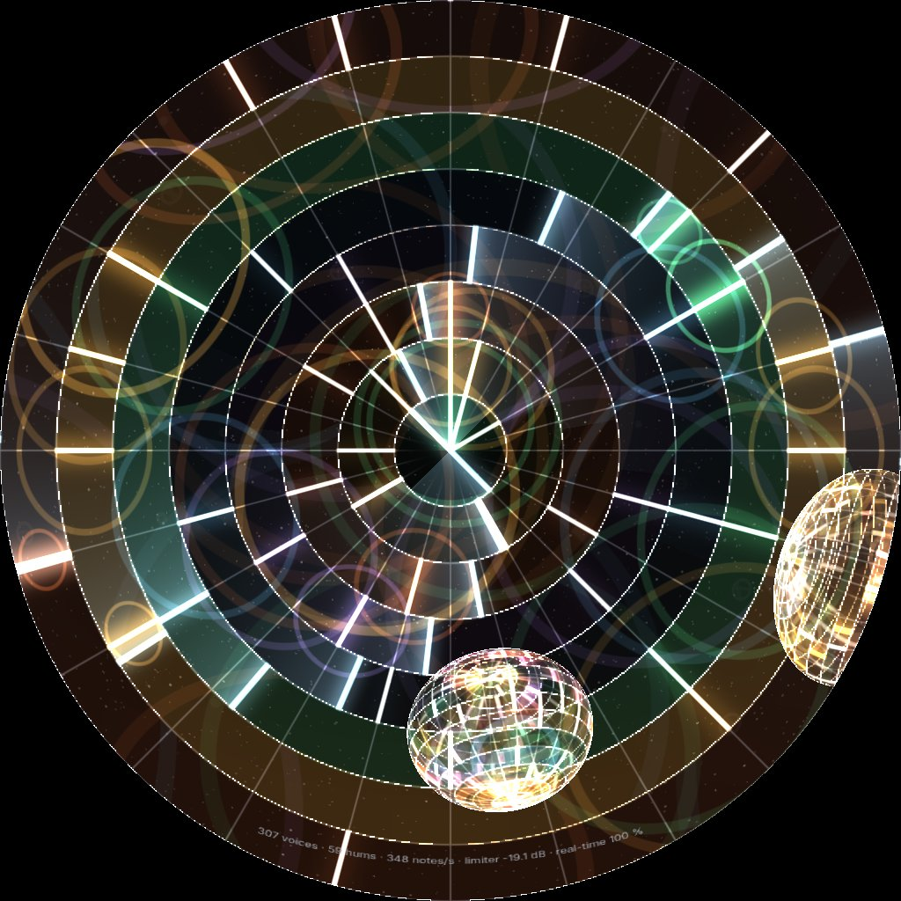

# EX-12 Orbit synth · WebGL + AudioWorklet

**A live piece · picture and 5.1 sound · runs in any recent browser · no install**

This is the same instrument as [EX-11 Orbit](ex11-orbit.md). Three spheres of mesh orbit in a void: a keyboard, drums and a guitar. Readers circle inside them and hum. Lines are notes. You play it the same way. What changes is how the sound is made. In EX-12 every sound comes from **one synthesiser that runs in an AudioWorklet**, and the page only sends it messages. That makes it cheap enough to play hundreds of notes at once, so this version also has a **stress test**: two sliders that fill the spheres until your laptop gives up.

{ width="480" }

## Files

| File | What it is |
|---|---|
| [`orbit-synth.html`](files/EX-12-orbit-synth/orbit-synth.html) | The whole piece, with the synthesiser inside it. One file, no libraries, no server. [Open it now](files/EX-12-orbit-synth/orbit-synth.html){ target="_blank" } or save it and double-click it |
| [`synth-worklet.js`](files/EX-12-orbit-synth/synth-worklet.js) | The synthesiser on its own, to read. The same code as inside the HTML. The page doesn't need it |
| [`README.md`](files/EX-12-orbit-synth/README.md) | The same notes as this page, to keep with the files |
| [`preview/`](files/EX-12-orbit-synth/preview/still-31s-names.jpg) | Three stills: [the score at 31 s with note names](files/EX-12-orbit-synth/preview/still-31s-names.jpg), [the stress test with the HUD](files/EX-12-orbit-synth/preview/stress-hud.jpg), [flown out, stress test running](files/EX-12-orbit-synth/preview/flyout-stress.jpg) |

## What it teaches

- **One synth instead of many audio nodes.** EX-11 builds a small graph of Web Audio nodes for every note, and has to cap them. Here a note is a few numbers in an array, so the limit is arithmetic, which you can measure.
- **Scheduling ahead on one clock.** Nothing is "detected" when a reader touches a line. The page solves for the exact time of every hit and tells the synth to start the note at that sample.
- **5.1 by hand.** Panning is six multiplications per sample, and the limiter is inside the synth, linked across all six channels.
- **Finding your machine's limit** before you are in the dome, not during the show.

## Run it

Open the file and press **Start sound**. The score plays by itself: one reader humming at first, a line straight ahead at 20 s, two more at 30 s. Then play.

| Do | What happens |
|---|---|
| **Click an empty cell** | A line appears. If that height has no reader, one starts on the line, so you hear the click at once |
| **Click a line** | Another reader at that height, starting from the line |
| ++shift++ **-click a line** | Removes it. A height's last line takes its readers with it |
| ++shift++ **+ drag** | Turns the sphere you are in (from outside: the one under the mouse) |
| **Fly out** (or ++o++) | Leave the sphere backwards and see all three spheres in the void. The further away, the quieter |
| **Double-click a sphere** (from outside) | Fly into it. **Into keyboard / drums / guitar** (or ++1++ ++2++ ++3++) do the same |
| **Clear my notes** (or ++c++) | Removes everything added by clicking |
| **Next line(s) now** (or ++n++) | Brings the next step of the score in early |
| ++r++ | Restarts everything: clicks, flights and rotations |

| Control | |
|---|---|
| **Dome output** | Fullscreen, square, no panel. This is what goes to the dome |
| **Save PNG dome master** | One frame, at the current picture size |
| **Picture size** (More settings) | 512² to 2160². The default, 1024², is what a laptop should hold at 30 fps or more |
| **Sphere** (More settings) | *With the dome* tilts each sphere with the dome, so every band stays on the screen. *Upright* makes eye level the equator |
| ++g++ | Comfortable zone and sweet spot guide |
| ++f++ | The rim and a front marker |
| ++i++ | The HUD on the dome, on or off |
| ++h++ | Hide the panel |

**Height is pitch.** Each sphere is cut into 10° bands from its rim to its pole, one note per band: C major (or A minor) pentatonic in the keyboard, kick, toms, snare, clap and hats in the drums, E minor pentatonic power chords in the guitar. Below the rim the scales go on downwards, and the drums have a second kit. [EX-11](ex11-orbit.md) has the full table.

The address takes a few settings, handy for testing: `?t=31` jumps the score to 31 s, `?q=2048` sets the picture size, `?extra=120&extraR=2` starts the stress test, `?names=1` shows note names, `?guides=1` turns the guide on, `?fly=out` starts outside, `?out=stereo` forces stereo.

## How it works

The page has two parts that share one clock.

**The world** is one function, `score(view, t)`. From the settings and everything that has happened (clicks, flights, rotations, all with their times), it works out where everything is at time `t`: the spheres on their orbit, the camera, every line and reader. A reader's angle is a closed-form function of time, so `hitsBetween()` can solve for the exact moment it crosses a line.

**The picture** is one fragment shader. For every pixel of the dome master it turns the pixel into a direction in the room (fisheye 160°, tilt 26°, front at the bottom edge), then ray-traces the three spheres from the camera. Lines and readers reach the shader through a small data texture, sorted by band, so each pixel only looks at the lines in its own band.

**The feeder** runs every 20 ms. It finds every hit in the next 250 ms (only lines in a reader's own band), and posts them to the synth as one message:

```js
{ type: 'notes', list: [{ when, bank, kind, f, len, vol, g: [L, R, C, LFE, Ls, Rs] }] }
```

`when` is on the AudioContext's clock, `g` holds the six speaker gains (where the line is, seen from the camera, times how far away its sphere is). Hums go as a list of "what should hum now": the 48 loudest readers. A hum that drops off the list fades out.

**The synth** (`synth-worklet.js`) starts each note at its exact sample. It renders every voice a block at a time (128 samples, 2.7 ms), adds it into six channels with its gains, low-passes the LFE and limits the sum with one limiter linked across all channels, so the image holds. Every 250 ms it reports back: voices, hums, notes per second, limiter reduction.

What makes it fast:

- Everything that changes slowly (FM depth, a drum's falling pitch, vibrato, envelopes) is worked out **once per block** and glided across it. Only phases and filters run per sample.
- **A sine table** and a **rational tanh** instead of `Math.sin` and `Math.tanh`.
- A sphere too far away to hear (gain below 0.003) isn't scheduled at all.
- Up to `MAX_VOICES = 2048` voices. No other caps, except one note per guitar string: a new note on a line lets the one before go.

**One clock.** Before the sound starts the page uses its own clock. When you press **Start sound** it switches to the audio clock, the moment you are hearing now, without a jump. The picture reads the same clock, so a line flashes when its note is heard.

| | EX-11 | EX-12 |
|---|---|---|
| A note is… | a small graph of Web Audio nodes (oscillators, gains, filters) built for it | a few numbers in an array inside one AudioWorklet |
| Panning (5.1) | a `Panner51` (7 nodes) per line | six multiplications per sample |
| Limiter | one `DynamicsCompressor` per speaker pair | inside the synth, linked across all six channels |
| Polyphony | capped (16 / 24 / 6), oldest let go | no caps (up to 2048 voices), only one note per guitar string |
| Cost | grows with the number of nodes the browser has to manage | grows with arithmetic: measurable, predictable |

### Why the synth is inside the HTML

Chrome refuses `audioWorklet.addModule()` for a `file://` address, so a double-clicked page can't load `synth-worklet.js` from the folder. The page carries the same code in a `<script id="worklet-src" type="text/plain">` block and loads it from a Blob URL. Opened from disk, Chrome refuses the Blob URL too, so there it uses a `data:` URL instead. Either way the separate file is only there to read. If you change the synth, change it in the HTML.

### 5.1 or stereo

When the sound starts, the page asks the output device how many channels it has. With 6 or more (Dante Virtual Soundcard set to 5.1, or the course's Dante box) it sends **six discrete channels in the order L R C LFE Ls Rs**, with nothing up- or down-mixed. With fewer, the synth folds its 5.1 mix down to stereo itself, before the limiter: C and the surrounds at −3 dB into each side, the LFE at −6 dB into both. The panel says which mode you are in.

## The stress test

Two sliders fill all three spheres with generated lines, always the same ones:

- **Generated lines per sphere**, 0 to 240.
- **Readers per height**, 1 to 4. Every height that gets lines gets this many readers.

The **HUD** at the front of the dome, just below the rim, shows:

> voices sounding · hums · notes per second · limiter reduction · **real-time %**

Real-time is how fast the audio clock runs against the wall clock. 100 % means the synth keeps up. Below that the audio thread is overloaded and you hear crackles. The panel shows the same numbers, plus how long the feeder takes and the picture's frame rate. Raise the sliders until real-time drops below about 98 % or the picture stutters: that is your computer's number. Do it with the picture running at the size you will use in the dome, because both share the machine.

Measured on 3 November 2026 on the cloud test machine (one core of a 2.1 GHz Xeon, Node / V8, the synth alone, no picture), as a share of one core:

| voices sounding at once | keyboard | drums | guitar | mixed |
|---|---|---|---|---|
| 100 | 15 % of a core | 11 % | 19 % | 25 % |
| 400 | 46 % | 28 % | 79 % | 71 % |
| 1000 | 98 % | 58 % | 185 % | 173 % |

So that machine manages about **550 mixed voices per core**. A rerun of the mixed column on 5 November 2026 on the same kind of machine (Node 22) gave 22 %, 68 % and 173 %. In headless Chromium on that machine, 120 generated lines per sphere (about 210 voices) stayed at 100 % real-time, and 240 lines with 4 readers per height (about 920 voices, 1200 notes per second) dropped to about 76 %. A recent laptop core should do roughly twice as well, but **measure it on your laptop**.

Musically the useful range is far below the limit: a few hundred voices is already a wash. The point is that the ceiling is now set by arithmetic you can measure and optimise, not by how many audio nodes the browser will juggle.

## Getting it onto the dome

The browser window is your output. The picture goes to the dome **over HDMI** and the sound **over Dante**; see [Connecting a live piece](../reference/connecting.md).

- **Picture:** the dome's display runs at 3840 × 2160. Put the browser on that display and press **Dome output**: the square master sits in the middle, 2160 × 2160, black at the sides. Set **Picture size** to 2160² if the laptop holds it, or capture the window in OBS and use its Fullscreen Projector.
- **Sound:** 5.1 over Dante, from Dante Virtual Soundcard or the course's Dante box. Make the Dante device the browser's output **before** you press **Start sound**, and check the panel says "5.1, six discrete channels". On Windows, set the Dante Virtual Soundcard playback device to 5.1 in the sound settings, or the browser only sees two channels.
- **Fallback:** if Dante fails, the HDMI cable carries stereo sound. The page folds the 5.1 mix down by itself.
- **Rehearse** in the [Dome Simulator](../tools/dome-simulator.html): share the window, use a virtual Dome monitor, or use a USB HDMI capture card (see [Making a live piece](../make/live.md#3-rehearse-on-your-laptop)).

The geometry is Wisdome's: fisheye **160°**, tilt 26°, front at the bottom edge of the master. Press ++g++ to see the comfortable zone (from the rim at the front, about −16°, up to about 45°, ±60° to the sides) and the sweet spot (straight ahead, about 20° up). Inside the keyboard, the score's band is 20° to 30° above the sphere's rim, which in front is about 4° to 14° above eye level: low in the zone, just under the sweet spot. See [Where to put things](../reference/comfortable-zone.md).

## Try changing first

- `blockNote()` in the synth: each sound bank is a few lines. A new bank is a new branch there and a new sphere in `SPHERES`.
- `MAX_VOICES` (2048): set it to 200 and push the stress test. The oldest voices are dropped and the sound thins out.
- `HUM_MAX` (48): how many readers hum at once.
- The keyboard's FM depth (`idx0`, `idx1`): bigger numbers make it brighter and harsher.
- Move the scheduling into the worklet too: send it the lines and readers and let it find the hits. Then there are no messages per note at all.

## What usually breaks

| Symptom | Cause |
|---|---|
| No sound, and the panel says the synth did not load | The browser has no AudioWorklet (very old browsers), or blocks `data:` URLs on pages opened from disk. Serve the folder (`python -m http.server`) and open it from `http://localhost:8000` |
| No sound, and nothing in the panel | Press **Start sound**. Browsers only start audio after a click |
| Stereo when you expected 5.1 | The output device has fewer than six channels when the sound starts. Set the Dante device to 5.1 first, make it the browser's output, then reload and press **Start sound** |
| Notes go missing when the picture stutters | Picture and feeder share the page's main thread. If one frame takes longer than about 250 ms, the feeder misses hits. Lower **Picture size** |
| Crackles, real-time below 98 % | The audio thread is overloaded. Fewer generated lines or readers, or a faster machine |
| The limiter shows −15 dB or more | Many notes at once. That is the limiter doing its job; the mix can't clip |
| The picture is stretched on the dome | The output is not square. Use **Dome output**, never a resized window |

## Licences

The code is GPL-3.0. The text and images are CC BY-SA 4.0.
