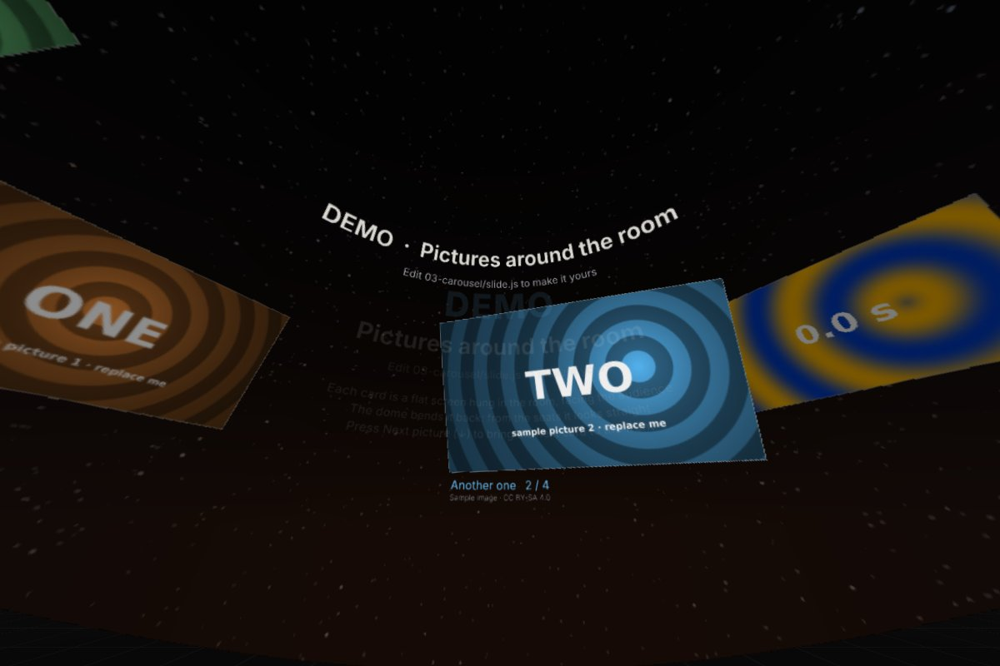

# EX-13 Simple HDMI + Dante example · live slides kit

**A live piece · picture over HDMI, 5.1 sound over Dante · Node.js + Chrome · a practice slide and five commented demo slides**

!!! tip "Never used Node.js or VS Code?"
    Start with [Live slides from zero](../make/live-slides-from-zero.md): installing the tools, starting the kit, and changing the practice slide, step by step, with the difficulty of each step marked.

A small version of the live slides engine used in the introductory lecture in Wisdome. It runs on your
laptop: one page draws the dome master (it goes on the HDMI output), one page plays six channels of
sound (they go to Dante Virtual Soundcard), and a presenter page controls both. It comes with **a practice slide and five demo
slides, one of each kind**, with comments in the code, so you can copy one and make your own.

{ width="480" }

## Files

| File | What it is |
|---|---|
| [`EX-13-simple-hdmi-dante.zip`](files/EX-13-simple-hdmi-dante.zip) | **Download this.** The whole kit, ready to run (without the two sample films) |
| [Sample films (.zip)](https://github.com/dcuartielles/wisdome-360/releases/download/examples-media/EX-13-sample-media.zip) | The sample video and the sample dome master, on GitHub Releases. Unzip into the kit folder, or make them yourself with `tools/make_sample_media.py` |
| [`README.md`](files/EX-13-simple-hdmi-dante/README.md) | All the instructions: starting it, testing in the browser, HDMI, Dante, preparing your sound, making a slide |
| [`slides/`](files/EX-13-simple-hdmi-dante/slides/index.js) | The practice slide and the five demo slides, each in its own folder with a commented `slide.js` |

| Demo slide | What it shows you |
|---|---|
| [**Start here**](files/EX-13-simple-hdmi-dante/slides/start-here/slide.js) | **the one to practise on**: words, a picture, a dot circling the room and a sound that follows it, in plain JavaScript with no shader code. See [Live slides from zero](../make/live-slides-from-zero.md) |
| [Test image](files/EX-13-simple-hdmi-dante/slides/00-test-card/slide.js) | where the front is, the screen edge, the sweet spot, the five speakers, a **Speaker ident** button |
| [Title screen](files/EX-13-simple-hdmi-dante/slides/01-title/slide.js) | text placed by angle, a turning starry sky, a drone that circles the room |
| [Sound that moves](files/EX-13-simple-hdmi-dante/slides/02-comet/slide.js) | a comet circling the room, its sound following it over the 5.1 speakers |
| [Carousel](files/EX-13-simple-hdmi-dante/slides/03-carousel/slide.js) | pictures and a video on cards around the room, one at a time to the front |
| [Dome film](files/EX-13-simple-hdmi-dante/slides/04-dome-film/slide.js) | a finished dome master film, full dome, with stereo or 5.1 sound |

## Quick start

1. Install [Node.js](https://nodejs.org) (20 or newer) and Chrome. Unzip the kit.
2. In the kit folder: `node server/server.mjs` (Windows: double-click `setup/Dome Slides.cmd`).
3. Open `http://localhost:8360/video/?audio=1&view=inside`, click once, and drag to look around: that is the
   dome from a seat, with sound. Open `http://localhost:8360/presenter/` in another window and press **→**.

In the dome, the picture page goes full screen on the HDMI output and the sound page plays into Dante
Virtual Soundcard. The [README](files/EX-13-simple-hdmi-dante/README.md) walks through both, and through
the fallback (stereo over HDMI) if Dante doesn't work. See also [Connecting a live piece](../reference/connecting.md), which has
the venue's own [3840 × 2160 test frame](../reference/connecting.md#the-venues-test-frame) to check your HDMI output against.

## What it teaches

- **Picture and sound as two pages that share one clock.** Neither talks to the other: both read the same
  shared state (`view.t()`, `view.p()`), so they stay together even on two computers.
- **Placing by angle.** Text, cards and sounds are all given an azimuth and an elevation. The sweet spot
  and the screen edge come from the venue's geometry, not from pixels.
- **5.1 from code.** One panner per sound: `p.set(azimuth, elevation)`. The speaker rings on the dome show
  what you hear.
- **A film is just a master.** The film slide reads the square file as it is; the projection does the rest.

## The full slideshow

The complete lecture slides (55 slides, the seminar demos, the Dante bridge for the Arduino UNO Q) are in
the repository's [`slides/`](https://github.com/dcuartielles/wisdome-360/tree/main/slides) folder, without
the pictures and films that belong to other people.
