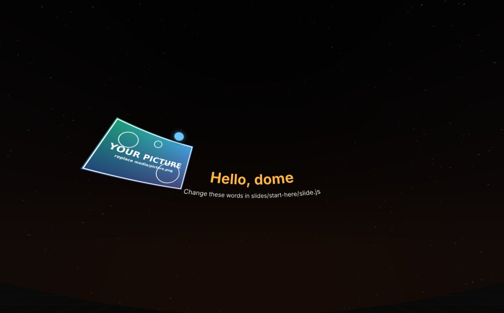
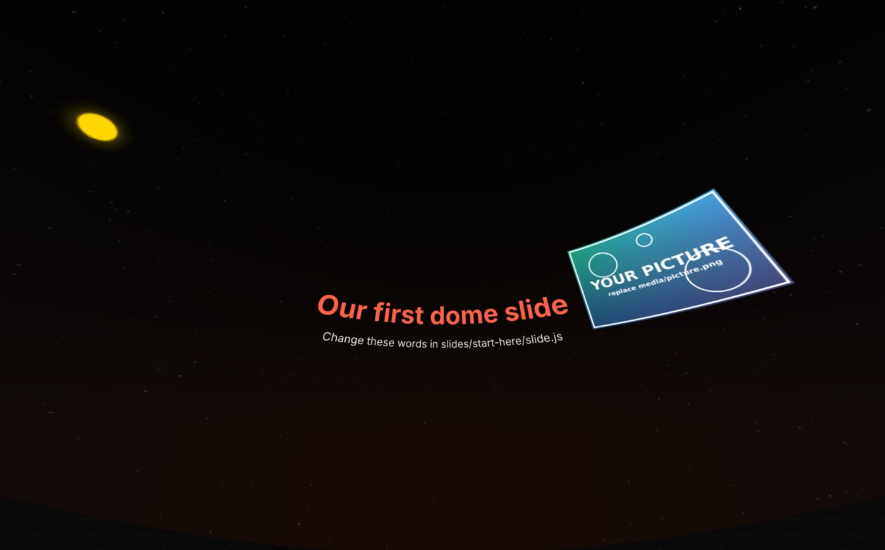

# Live slides from zero

This page takes you from a laptop with nothing installed to a dome slide you have changed yourself. It uses the live slides kit from [EX-13](../examples/ex13-simple-hdmi-dante.md) and its practice slide, **Start here**: some words, a picture, a dot that circles the room and a sound that follows the dot.

You don't need to know how to program. You will change values in a text file, save it and look at the result. Every step ends with **You should now see…** so you know whether it worked before you go on.

## How hard is each step?

Each step is marked with how hard it usually is for someone who has never done this before:

- ★☆☆ **Easy:** click through, or change one thing. Hard to get wrong.
- ★★☆ **Medium:** one new idea, or typing a command exactly. Read the step to the end before you start.
- ★★★ **Harder:** several things have to be right at once. Go slowly; most problems are a missing quote or comma.

| Step | | Difficulty | Time |
|---|---|---|---|
| 1 | [What Node.js is](#1-what-nodejs-is) | ★☆☆ reading | 3 min |
| 2 | [Install Node.js](#2-install-nodejs) | ★☆☆ (Linux ★★☆) | 10 min |
| 3 | [Install Visual Studio Code](#3-install-visual-studio-code) | ★☆☆ | 10 min |
| 4 | [Get the kit and unzip it](#4-get-the-kit-and-unzip-it) | ★★☆ | 5 min |
| 5 | [Open the folder in VS Code](#5-open-the-folder-in-vs-code) | ★☆☆ | 3 min |
| 6 | [Start the server](#6-start-the-server) | ★★☆ | 5 min |
| 7 | [Look at the dome in Chrome](#7-look-at-the-dome-in-chrome) | ★☆☆ | 5 min |
| 8 | [Change the words](#8-change-the-words) | ★☆☆ | 5 min |
| 9 | [Change the colours](#9-change-the-colours) | ★☆☆ | 5 min |
| 10 | [Move things by angle](#10-move-things-by-angle) | ★★☆ | 10 min |
| 11 | [Use your own picture](#11-use-your-own-picture) | ★★☆ | 10 min |
| 12 | [Change the dot and its sound](#12-change-the-dot-and-its-sound) | ★★☆ | 10 min |
| 13 | [Make a slide of your own](#13-make-a-slide-of-your-own) | ★★★ | 20 min |
| 14 | [Stop, and start again next time](#14-stop-and-start-again-next-time) | ★☆☆ | 2 min |

About two hours the first time, most of it in steps 8–13. **What you need:** a laptop with Windows, macOS or Linux, permission to install programs on it, **Google Chrome**, an internet connection for the downloads, and headphones.

---

## 1 · What Node.js is

**Difficulty: ★☆☆ easy, reading** · about 3 min

A web page normally comes from a server somewhere on the internet. The slides kit is a set of web pages too, but the server runs **on your own laptop**. **Node.js** ("Node") is the program that runs it: it runs JavaScript outside the browser.

Here Node does two small jobs:

1. it hands the slide files to Chrome, and
2. it keeps every open page in step: the picture page, the sound page and the presenter all show the same slide at the same moment.

Why not just double-click the HTML file? Chrome refuses to load the slide files straight from your disk, for safety. Through the little server on your laptop, it loads them like any web page. Nothing goes on the internet: the server only answers your own laptop (and, if you want, other computers on the same network).

**VS Code** (Visual Studio Code), in step 3, is the text editor you change the slides in. It colours the code so it's easier to read, and has a built-in terminal: the window where you type the one command that starts the server.

## 2 · Install Node.js

**Difficulty: ★☆☆ easy** (Linux ★★☆) · about 10 min

Install Node **before** VS Code: then VS Code finds it straight away.

=== "Windows"

    1. Go to [nodejs.org](https://nodejs.org) and download the version marked **LTS** (long-term support), the **Windows Installer (.msi)**.
    2. Run it and accept the defaults with **Next**. On the page *Tools for Native Modules*, leave the box **unticked**: the kit doesn't need them.
    3. Open the **Start** menu, type `cmd`, and open **Command Prompt**. Type `node -v` and press Enter.

=== "macOS"

    1. Go to [nodejs.org](https://nodejs.org) and download the version marked **LTS**, the **macOS Installer (.pkg)**.
    2. Open it and click through with **Continue** and **Install**. It asks for your Mac's password.
    3. Open **Terminal** (⌘ Space, type `Terminal`). Type `node -v` and press Return.

=== "Linux"

    The `nodejs` package in many distributions is too old (the kit needs version 20 or newer), so use the official route:

    1. Go to [nodejs.org/en/download](https://nodejs.org/en/download), choose **LTS**, **Linux** and **nvm**. The page shows a few commands.
    2. Open a terminal, paste the commands one at a time and press Enter after each. Close the terminal and open a new one when the page says so.
    3. Type `node -v` and press Enter.

**You should now see** a version number such as `v24.11.0`. Any number from **20** up is fine.

**If not:** `'node' is not recognized` (Windows) or `command not found` (macOS, Linux) means the terminal was open before Node was installed. Close it, open a new one and try again. Still nothing: restart the laptop.

## 3 · Install Visual Studio Code

**Difficulty: ★☆☆ easy** · about 10 min

=== "Windows"

    1. Download it from [code.visualstudio.com](https://code.visualstudio.com) (**Windows**, the *User Installer*).
    2. Run it. On *Select Additional Tasks*, tick **Add "Open with Code" action to Windows Explorer directory context menu**: then you can right-click a folder and open it in VS Code. Keep **Add to PATH** ticked.

=== "macOS"

    1. Download it from [code.visualstudio.com](https://code.visualstudio.com) (**Mac**, *Universal*).
    2. Open the downloaded file and drag **Visual Studio Code** into **Applications**. Start it from there. The first time, macOS asks whether you want to open an app downloaded from the internet: **Open**.

=== "Linux"

    1. Download the **.deb** (Ubuntu, Debian, Mint) or **.rpm** (Fedora) from [code.visualstudio.com](https://code.visualstudio.com).
    2. Open it with your software installer, or in a terminal: `sudo apt install ./code_*.deb` (or `sudo dnf install ./code-*.rpm`).

**You should now see** VS Code's *Welcome* page. You don't need any extensions; if VS Code offers some, you can say no.

## 4 · Get the kit and unzip it

**Difficulty: ★★☆ medium** · about 5 min · *the step where most people go wrong: read it to the end first*

1. Download [`EX-13-simple-hdmi-dante.zip`](../examples/files/EX-13-simple-hdmi-dante.zip) (about 1.5 MB).
2. Make a folder for your dome work that's easy to find, for example **`dome`** in your user folder:
   `C:\Users\yourname\dome` on Windows, `/Users/yourname/dome` on a Mac, `/home/yourname/dome` on Linux.
3. **Unzip** the kit into it.
    - **Windows:** right-click the zip › **Extract All…**, choose your `dome` folder, **Extract**. Don't just double-click the zip: Windows then shows the files *inside* the zip, and the kit can't run from there.
    - **macOS:** double-click the zip; it unzips into *Downloads*. Drag the folder `EX-13-simple-hdmi-dante` into your `dome` folder.
    - **Linux:** right-click › *Extract here*, or `unzip EX-13-simple-hdmi-dante.zip -d ~/dome`.

**You should now see** a folder `EX-13-simple-hdmi-dante` that **directly** contains the folders `server`, `slides`, `lib`, `video`… and a `README.md`.

**If not:** Windows sometimes makes a folder inside a folder: `EX-13-simple-hdmi-dante\EX-13-simple-hdmi-dante\server`. That's fine, but remember to use the **inner** one, the one with `server` in it, in the next step.

A folder synced by OneDrive, iCloud or Dropbox (often *Documents* and *Desktop*) works, but the syncing can get in the way while you save files every few seconds. A plain folder in your user folder is safer.

## 5 · Open the folder in VS Code

**Difficulty: ★☆☆ easy** · about 3 min

1. In VS Code: **File › Open Folder…** (on a Mac: **File › Open…**). Choose the `EX-13-simple-hdmi-dante` folder, the one with `server` inside, and click **Select Folder** / **Open**.
2. VS Code asks **"Do you trust the authors of the files in this folder?"** Choose **Yes, I trust the authors**.

**You should now see** the list of files on the left (the *Explorer*), with `server`, `slides`, `lib`… at the top level. Click the arrow next to `slides` and then `start-here`: inside is `slide.js` and a `media` folder. **`slides/start-here/slide.js` is the only file you change in steps 8–12.** Everything else is the engine; you can leave it alone.

**If not:** if you see only one folder called `EX-13-simple-hdmi-dante` on the left, you opened the outer folder. Open the inner one.

## 6 · Start the server

**Difficulty: ★★☆ medium** · about 5 min · *typing one command exactly*

1. Open the terminal inside VS Code: **Terminal › New Terminal**. It opens at the bottom, already in the kit's folder.
2. Type this and press Enter:

    ```bash
    node server/server.mjs
    ```

**You should now see:**

```text
Dome slides server on port 8360
  presenter  http://localhost:8360/presenter/
  video      http://localhost:8360/video/        (OBS Browser Source, 2048 x 2048)
  audio      http://localhost:8360/audio/        (Chrome tab → Dante / 5.1 device)
  rehearse   http://localhost:8360/video/?audio=1&view=inside   (one tab, picture + sound)
```

(and perhaps a line *on the LAN* with your laptop's network address).

The terminal now **belongs to the server**: it doesn't come back with a new line to type on. That's correct. Leave it open while you work; closing it stops the slides.

**If not:**

- `Cannot find module …server.mjs`: the terminal is not in the kit's folder. Check step 5 (did you open the folder with `server` in it?), then open a new terminal.
- `Port 8360 is busy`: the server is already running, perhaps in another terminal or window. Use that one, or close it first.
- Windows asks whether Node may use the network: **Allow** for private networks.

On Windows you can also start it by double-clicking `setup\Dome Slides.cmd` in the kit, without VS Code.

## 7 · Look at the dome in Chrome

**Difficulty: ★☆☆ easy** · about 5 min

1. In Chrome, open **`http://localhost:8360/video/?audio=1&view=inside`**. In VS Code you can also Ctrl-click (⌘-click) the *rehearse* address in the terminal.
2. Click once on the page to start the sound (browsers only play sound after a click). Put on headphones.
3. **Drag** with the mouse to look around, as if you sat in the dome. The mouse wheel zooms.

**You should now see** this: "Hello, dome" straight ahead, a picture to the left, and a blue dot circling the room. With headphones on, you hear a soft chord that moves with the dot.



That is the dome seen **from a seat**. Without `&view=inside` at the end of the address, you see the **dome master**: the round picture that actually goes to the venue. Both are right; the seat view is easier to judge.

**If not:** a black page means the server isn't running (step 6) or the address has a typo. No sound: click the page once more, and check the volume.

## 8 · Change the words

**Difficulty: ★☆☆ easy** · about 5 min · *the loop you'll use for everything: change, save, reload*

1. In VS Code, open **`slides/start-here/slide.js`**. The top part, under `── 1. The words ──`, looks like this:

    ```js
    const TITLE = 'Hello, dome';
    const SUBTITLE = 'Change these words in slides/start-here/slide.js';
    ```

2. Change the words **between the quotes**, e.g. `'Our first dome slide'`. Keep the quotes and the `;` at the end.
3. **Save:** Ctrl+S (macOS ⌘S). A white dot on the file's tab means "not saved yet"; it disappears when it's saved.
4. **Reload** the Chrome tab: F5 (macOS ⌘R).

**You should now see** your new words in the dome.

**If not:** the dome says **The slide "start-here" has a mistake in it**: you probably deleted a quote. VS Code marks the spot with a **red wavy underline**. Fix it, or press Ctrl+Z (⌘Z) to undo, then save and reload. A word with an apostrophe (`'Anna's dome'`) breaks the quotes; use double quotes around it: `"Anna's dome"`.

## 9 · Change the colours

**Difficulty: ★☆☆ easy** · about 5 min

Colours are written in quotes, either as a name or as a code:

```js
const TITLE_COLOUR = 'tomato';     // a name: 'white', 'gold', 'tomato', 'deepskyblue', 'hotpink'…
const DOT_COLOUR = '#6cc6ff';      // a code: # and six digits, red-green-blue
```

Change `TITLE_COLOUR` and `DOT_COLOUR`, save, reload. To find a code for a colour you like, search the web for "colour picker": it shows the `#` code of any colour you click.

**You should now see** the title and the dot in your colours.

Bright, light colours read best on a dark dome. Pure white over a large area dazzles in the dark and lights up the whole room; keep large areas dark.

## 10 · Move things by angle

**Difficulty: ★★☆ medium** · about 10 min · *the one idea this whole kit is built on*

In a dome you don't place things in pixels but in **angles**, as seen from the middle of the room:

- **az** (azimuth) is left–right: `0` straight ahead, `90` right, `-90` left, `180` behind you.
- **el** (elevation) is up–down: `0` eye level, `90` straight up.
- **Sizes** are in degrees too: the title is 4° tall. As a rule, a letter should be **at least 1.5° tall** to be read from every seat.

The best place in this dome is the **sweet spot**, about **20° up, straight ahead**. The kit calls it `dome.sweetSpot`; the title sits on it. Put what matters most there, and keep things roughly between 60° left and 60° right: people don't turn round in their seats.

Try this:

1. Move the picture to the right: `const PICTURE_AZ = 45;`
2. Make it bigger: `const PICTURE_WIDTH = 35;`
3. Make the title bigger: `const TITLE_SIZE = 6;`
4. Save, reload, and look at the result in the seat view. Then look at the dome master (the address without `&view=inside`): straight lines in the room become curves in the master. That's expected.



**You should now see** the picture on the right. If it overlaps the title, it is too close: the picture is centred on `PICTURE_AZ` and is `PICTURE_WIDTH` degrees wide, so half of it reaches towards the middle.

**If not:** a value with nothing after the `=` makes the slide fail to load (the dome says the slide *has a mistake in it*). Look for the red wavy underline in VS Code and compare your line with the lines around it.

## 11 · Use your own picture

**Difficulty: ★★☆ medium** · about 10 min · *file names have to match exactly*

1. Choose a picture: **.jpg**, **.png** or **.webp**. About 1000–2000 pixels wide is plenty.
2. Copy it into `slides/start-here/media/`. You can drag it from your file browser onto the `media` folder in VS Code's file list.
3. In `slide.js`, change the file name:

    ```js
    const PICTURE = 'media/my-photo.jpg';
    ```

4. Save, reload.

**You should now see** your picture where the sample was. Its height follows its own shape; only the width is set.

**If not:** a red box saying **picture not found** shows the name the slide looked for. Compare it letter by letter with the file: capitals count (`Photo.JPG` is not `photo.jpg`), and so do spaces. Easiest: give the file a short name with small letters and no spaces.

Use only pictures you made yourself or are allowed to use, and write down where they came from.

## 12 · Change the dot and its sound

**Difficulty: ★★☆ medium** · about 10 min · *one new idea: something that changes over time*

The dot's position is worked out again 30 times a second, from the time since the slide started (`t`, in seconds):

```js
function dotAt(t) {
  return { az: t * DOT_SPEED, el: DOT_HEIGHT };
}
```

After 1 second the dot is at 20°, after 2 seconds at 40°, and so on round the room. The sound asks the same function where to be, so it always comes from the dot.

1. Change `DOT_SPEED` (try `60`, then `-10`) and `DOT_HEIGHT` (try `20`, then `60`). Save, reload, and follow the dot with your eyes closed.
2. Change the sound: put a sound file (`.wav`, `.mp3` or `.ogg`) in `media/` and set `const SOUND_FILE = 'media/my-sound.wav';`. It loops. Or set `const SOUND_FILE = null;` (no quotes) for a plain tone, and change its pitch with `NOTE`.
3. Keep `SOUND_VOLUME` low, around `0.3`. A dome is a loud, echoing room.

**You should now see** the dot move at the new speed and height, and **hear** the sound follow it.

On headphones you hear a stereo mix. In the dome the same sound is spread over five speakers (5.1). There are no speakers above you, so height changes the sound very little.

**Want to go further?** The dot can do anything you can write as a formula of `t`. For example, `az: 60 * Math.sin(t)` swings it from left to right and back.

## 13 · Make a slide of your own

**Difficulty: ★★★ harder** · about 20 min · *two files, and the punctuation has to be right*

1. In VS Code's file list, right-click `slides/start-here` › **Copy**, then right-click `slides` › **Paste**. Rename the copy (right-click › **Rename**) to **`05-my-slide`**: small letters, no spaces.
2. Open `slides/05-my-slide/slide.js` and give it its own name: `title: 'My slide',`
3. Open **`slides/index.js`**. It lists the slides in the order they're shown. Add your folder's name, **with quotes and a comma**, where you want it:

    ```js
    export const ORDER = [
      'start-here',
      '05-my-slide',    // ← new line
      '00-test-card',
      …
    ];
    ```

4. Save both files. Reload the Chrome tab.
5. Open the **presenter**, `http://localhost:8360/presenter/`, in another window. Your slide is in the list on the right. Click it, or press **→** to go to the next slide. The dome tab changes with it.

**You should now see** your slide as the second one in the presenter's list.

**If not:**

- The dome stays black and the presenter's list is empty: there's a mistake in `index.js`. Look for a red wavy underline; check every name has quotes on both sides and a comma after it.
- Only your slide says it *has a mistake in it*: the name in `index.js` and the folder's name differ, or there's a mistake in your `slide.js`.
- For more detail: in Chrome press **F12** (macOS ⌥⌘J) and open the **Console** tab. The red lines say which slide failed and why.

## 14 · Stop, and start again next time

**Difficulty: ★☆☆ easy** · about 2 min

- **Stop** the server: click in VS Code's terminal and press **Ctrl+C** (on a Mac too: Ctrl, not ⌘). Closing VS Code stops it as well.
- **Next time:** open VS Code (it reopens the kit's folder), **Terminal › New Terminal**, `node server/server.mjs`, and open the Chrome tab again. The terminal remembers commands: press **↑** to get the last one back.

## When it breaks

| What you see | What to try |
|---|---|
| `'node' is not recognized` / `command not found: node` | Node is not installed, or the terminal was open before you installed it. Open a new terminal; if that doesn't help, restart the laptop (step 2) |
| `Cannot find module …server.mjs` | The terminal is in the wrong folder. Open the folder with `server` in it (steps 4–5) |
| `Port 8360 is busy` | The server is already running somewhere. Use that one, or stop it with Ctrl+C |
| Chrome: *This site can't be reached* | The server isn't running, or you closed its terminal. Start it again (step 6) |
| My change doesn't show | Did you **save** (no white dot on the tab)? Did you **reload** the Chrome tab? Are you changing the file in the kit you started? |
| The dome says *The slide "…" has a mistake in it* | A typo in that `slide.js`: usually a missing quote, comma or bracket. VS Code underlines it with a red wavy line. Fix it, or undo (Ctrl+Z) until it works |
| A red **picture not found** box | The file name in `slide.js` and in `media/` differ. Capitals and spaces count |
| No sound | Click the page once. Check the **Sound** switch on the presenter and the laptop's volume. Is `SOUND_VOLUME` above 0? |
| The page is slow and jerky | Close other tabs and programs. On a laptop, plug in the charger: on battery, the graphics often slow down |

Still stuck: note what you did, what you expected, and the first red line of the Console (F12, macOS ⌥⌘J), and ask. With those three, the problem is usually found in a minute.

## Where next

- **The other demo slides** in the kit (test image, title, comet, carousel, dome film) ★★★: they draw their picture in **GLSL**, a small language that runs on the graphics card. Read them, change the values marked in their comments, and copy the parts you need. The kit's [README](../examples/files/EX-13-simple-hdmi-dante/README.md) has a cheat sheet.
- **In the dome itself**: the picture goes over HDMI and the sound over Dante. The README walks through both, and [Connecting a live piece](../reference/connecting.md) explains the venue's side.
- **Before you place anything important**: [Where to put things](../reference/comfortable-zone.md).
