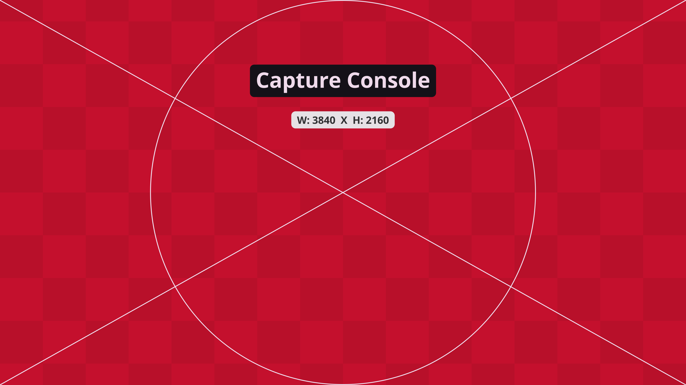

# Connecting a live piece

A live piece runs on your laptop, which is plugged into the dome's system. The picture goes **over HDMI** and the sound goes **over Dante**, in 5.1. If Dante fails, the HDMI cable can carry the sound too, but only in stereo.

| | **Picture** | **Sound** |
|---|---|---|
| How | HDMI cable into the venue's video input | Dante, over an Ethernet cable into the venue's audio network |
| Format | 3840 × 2160 (16:9), with the dome master centred as a 2160 × 2160 square | 6 channels, 5.1: L, R, C, LFE, Ls, Rs |
| What you need | An HDMI output (or a USB-C/Thunderbolt adapter), and OBS or your tool's fullscreen output | A Dante sender: **Dante Virtual Soundcard** (Audinate, paid licence) or a hardware Dante interface, plus one Ethernet port |
| Fallback | | Sound inside the HDMI cable: **stereo only** |

The venue also has an NDI network input, but we don't use it for student pieces.

MaU students: the course has a Dante box you can use instead of buying Dante Virtual Soundcard. See [MaU course 2026](../course/index.md#two-tracks).

## The picture: HDMI

The dome's HDMI input runs at **3840 × 2160**. Put the dome master in the middle as a square, 2160 × 2160, with black at the sides. That keeps all the detail of a 2048² master. At 1920 × 1080 the dome would only get 1080², about half the detail, so check the resolution.

1. Plug in the HDMI cable and set your laptop to **extend** the desktop to it (Windows: ++win+p++ → *Extend*; macOS: *Displays* → *Extend*). Set that display to **3840 × 2160**.
2. Put your piece fullscreen on that display, centred, with black at the sides. The simplest way is OBS (below); some tools can do it themselves.
3. Check the resolution again while connected. Some adapters quietly drop to 1080p.

### The venue's test frame

This is the frame the venue's capture console expects, shared by the Wisdome technicians: **3840 × 2160**,
with the circle of the dome master in the middle. The circle is 2160 pixels across and touches the top and
bottom edges. Everything outside it is not projected.

[Download the full-size frame](images/capture-console-3840x2160.jpg) and use it to check your output before you come:
put it fullscreen on your HDMI display (or as the OBS canvas), and lay your own picture over it.
Your dome master's circle should sit exactly on the white circle, and the diagonals should cross at its centre.

### Sending the picture with OBS

[OBS Studio](https://obsproject.com) (free, Windows, macOS, Linux) works with any tool.

1. *Settings → Video*: **Base (canvas)** and **Output (scaled)** resolution both **3840 × 2160**, 30 fps.
2. Add a source with your piece: *Window Capture* or *Display Capture* (*Game Capture* for some engines).
3. Make it a 2160 × 2160 square in the middle of the canvas: right-click → *Transform → Edit Transform*, size 2160 × 2160, position 840, 0. Check the circle touches the top and bottom edges.
4. Right-click the preview → **Fullscreen Projector (Preview)** → pick the HDMI display.

OBS adds a frame or two of delay. That is fine for the picture, but check the sync with the sound in the room.

**Rehearse it.** Plug the HDMI output into a USB capture card and pick the card in the [Dome Simulator](../tools/dome-simulator.html) under **Camera / capture card**. Your laptop sees the card as a second display, just as it will see the dome. Without a card, share the OBS projector window in the simulator instead.

## The sound: Dante

Send **six channels** by Dante, in the order **L, R, C, LFE, Ls, Rs**, over an Ethernet cable into the venue's Dante network. The venue routes your channels into the room.

- **Dante Virtual Soundcard** turns your laptop's Ethernet port into a Dante device. Your tool sends 6 channels to it like to any sound card. It is paid software (Audinate); a trial licence works for testing.
- **A hardware Dante interface** does the same job as a box between your laptop and the network.
- **Sample rate:** start at 48 kHz.
- **Stereo pieces** send L and R only.

**Check the sync in the room.** Picture and sound travel by different cables, so they can arrive at slightly different times. At the dry run, play something with a sharp flash and a click together and watch from the seats. If they drift apart, delay the sound (or the picture) in your piece.

**Rehearse it.** Dante can only be tested with a real Dante device or in the venue. Before that, check your 6-channel mix on headphones or any surround setup you can borrow.

## Fallback: sound over HDMI

If Dante doesn't work on the day, the HDMI cable can carry the sound too, but the dome takes it as **stereo**. Keep a stereo mix of your piece ready, and know how to switch your tool's output to the HDMI sound device.

## Whichever way it goes

- **Keep a fallback recording.** Record your piece running, convert it to the [delivery spec](delivery-spec.md), and bring it. If the laptop fails, the recording plays.
- **Write a runbook:** how a stranger starts your system in under two minutes, in which order to plug things in and launch them.
- **Test before the day,** with the same laptop, cables and adapters.
